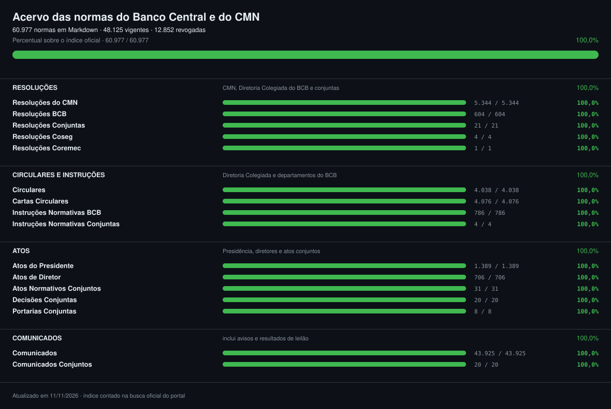
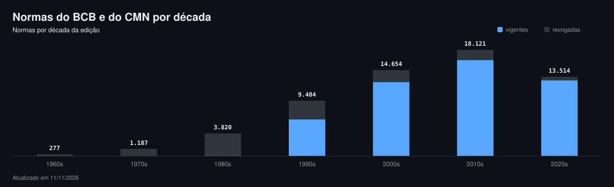

# Normas do Banco Central e do CMN em Markdown

Todos os normativos do Banco Central do Brasil e do Conselho Monetário Nacional, convertidos das fontes
oficiais para Markdown, com cabeçalho estruturado e link para a origem de cada texto: resoluções do CMN e
do BCB, resoluções conjuntas, circulares, cartas circulares, instruções normativas, atos do presidente e
de diretor, comunicados e as demais séries, de 1965 até hoje. As contagens do acervo publicado são
atualizadas a cada coleta, aqui e em **[COBERTURA.md](COBERTURA.md)**.

O objetivo é ter **toda a regulação do Sistema Financeiro Nacional** num lugar só, em texto simples, de
graça, para qualquer pessoa e para qualquer IA ler: cada norma com a situação (vigente, revogada ou
cancelada), as atualizações que sofreu, as normas vinculadas, as leis em que se baseia e o texto oficial.

Faz par com [normas-cvm](https://github.com/BrunooMoniz/normas-cvm) (mercado de capitais) e segue o formato
do [ctresb/leis](https://github.com/ctresb/leis), que reúne a legislação brasileira. O Banco Central não
edita leis: as do Sistema Financeiro Nacional (Lei 4.595/1964, Lei 9.069/1995, Lei Complementar 105/2001
e as demais) estão lá, em `federal/`; aqui ficam só os atos do BCB e do CMN.

> [!IMPORTANT]
> Os textos têm caráter informativo e **não substituem a publicação no Diário Oficial da União** nem o
> portal do BCB. São conversões automáticas, com OCR nos documentos escaneados. Confira sempre a fonte
> indicada no cabeçalho antes de citar.

---

## Acervo

<!-- acervo:inicio -->
[](COBERTURA.md)

### Por série

| Série | No índice oficial | Publicadas | Vigentes | Revogadas | Período |
| --- | ---: | ---: | ---: | ---: | ---: |
| [Comunicados](comunicados/) | 43.938 | 43.938 | 43.835 | 103 | 1990 a 2026 |
| [Resoluções do CMN](resolucoes-cmn/) | 5.344 | 5.344 | 810 | 4.534 | 1965 a 2026 |
| [Cartas Circulares](cartas-circulares/) | 4.076 | 4.076 | 106 | 3.970 | 1968 a 2020 |
| [Circulares](circulares/) | 4.038 | 4.038 | 155 | 3.883 | 1965 a 2020 |
| [Atos do Presidente](atos-do-presidente/) | 1.391 | 1.391 | 1.390 | 1 | 1994 a 2026 |
| [Instruções Normativas BCB](instrucoes-normativas-bcb/) | 786 | 786 | 512 | 274 | 2020 a 2026 |
| [Atos de Diretor](atos-de-diretor/) | 706 | 706 | 704 | 2 | 1996 a 2026 |
| [Resoluções BCB](resolucoes-bcb/) | 604 | 604 | 526 | 78 | 2020 a 2026 |
| [Atos Normativos Conjuntos](atos-normativos-conjuntos/) | 31 | 31 | 30 | 1 | 2003 a 2026 |
| [Resoluções Conjuntas](resolucoes-conjuntas/) | 21 | 21 | 20 | 1 | 2020 a 2026 |
| [Decisões Conjuntas](decisoes-conjuntas/) | 20 | 20 | 19 | 1 | 1994 a 2015 |
| [Comunicados Conjuntos](comunicados-conjuntos/) | 20 | 20 | 20 | 0 | 1990 a 1993 |
| [Portarias Conjuntas](portarias-conjuntas/) | 8 | 8 | 8 | 0 | 2020 a 2026 |
| [Resoluções Coseg](resolucoes-coseg/) | 4 | 4 | 4 | 0 | 2026 a 2026 |
| [Instruções Normativas Conjuntas](instrucoes-normativas-conjuntas/) | 4 | 4 | 0 | 4 | 2021 a 2026 |
| [Resoluções Coremec](resolucoes-coremec/) | 1 | 1 | 1 | 0 | 2020 a 2020 |
| **Total** | **60.992** | **60.992** | **48.140** | **12.852** |  |

Vigentes são as que o portal não marca como revogadas nem canceladas.

### Por década



### Áreas do BCB que mais publicam

| Áreas | Normas |
| --- | ---: |
| DEORF | 18.560 |
| SECRE | 11.728 |
| DEMAB | 10.854 |
| DEPEC | 5.053 |
| DEPIN | 3.120 |
| DENOR | 1.610 |
| DEASF | 1.230 |
| PRESI | 922 |
| DEBAN | 803 |
| DEPAD | 681 |
| DESIG | 673 |
| DEINF | 465 |
| DECAM | 372 |
| DELIQ | 340 |
| DECAD | 237 |

_Números de 13/11/2026, gerados por `scripts/readme.py`._
<!-- acervo:fim -->

A coleta completa leva cerca de um dia e segue esta ordem: resoluções, circulares, instruções normativas,
cartas circulares, atos e, por último, os comunicados (a maioria são avisos e resultados de leilão). O
que ficou de fora e por quê está em [COBERTURA.md](COBERTURA.md) e, linha por linha, em
[`_falhas.jsonl`](_falhas.jsonl).

## Fonte

Tudo vem da [busca de normas do Banco Central](https://www.bcb.gov.br/estabilidadefinanceira/buscanormas):
o índice sai da própria busca e o texto, da página oficial de cada norma. Quando a página não traz o
texto, ele vem do PDF oficial. Nada é digitado à mão.

---

## Estrutura

```
resolucoes-cmn/AAAA/resolucao-cmn-NNNN.md        Resoluções do CMN, nº 1 (1965) em diante, numa série só
resolucoes-bcb/AAAA/resolucao-bcb-NNNN.md        Resoluções BCB (2020 em diante)
resolucoes-conjuntas/                            Resoluções conjuntas
circulares/  cartas-circulares/                  Circulares e Cartas Circulares
instrucoes-normativas-bcb/                       Instruções Normativas BCB
atos-do-presidente/  atos-de-diretor/            Atos do Presidente e de Diretor
comunicados/  comunicados-conjuntos/             Comunicados (inclui os avisos e resultados de leilão)
decisoes-conjuntas/  portarias-conjuntas/  atos-normativos-conjuntos/  instrucoes-normativas-conjuntas/
resolucoes-coseg/  resolucoes-coremec/
scripts/bcb.py                                   o código que baixa, converte e mede
COBERTURA.md                                     números por pasta e lacunas
progresso.svg  decadas.svg                      o painel de progresso e o gráfico por década
scripts/readme.py                                gera os números deste README
_falhas.jsonl                                    o que não entrou, linha por linha, e por quê
```

`AAAA` é o ano da norma. As resoluções do CMN anteriores a julho de 2020 se chamam "Resolução" no portal
(nº 1 a 4.838); daí em diante, "Resolução CMN" (4.839 em diante). Como a numeração é contínua, as duas
ficam na mesma pasta. Fora do versionamento, porque o script os reproduz: `_fonte/` (o JSON de cada norma
e os PDFs) e `_indice/`.

## Formato dos arquivos

```markdown
---
titulo: "Resolução CMN N° 4.839"
orgao: "Conselho Monetário Nacional"
tipo: "Resolução CMN"
numero: "4839"
data: 2020-07-30
ementa: "Altera o preço de referência para as operações de Financiamento Especial para Estocagem ..."
revogada: true
responsavel: "SECRE"
versao_texto: "texto do portal do BCB"
versao_normativo: "2"
publicacao: "Publicada no DOU de 3/8/2020, Seção 1, p. 53."
atualizacoes: ["Resolução CMN nº 4.903/2021 - Revogação total, a partir de 1º/5/2021."]
normas_vinculadas: ["RESOLUÇÃO CMN 4903/2021"]
referencias: ["Lei nº 4.595/1964, arts. 4º, inciso VI, e 9º.", "..."]
fonte: "https://www.bcb.gov.br/estabilidadefinanceira/exibenormativo?tipo=Resolu%C3%A7%C3%A3o%20CMN&numero=4839"
baixado_em: 2026-11-10
---
# Resolução CMN N° 4.839

RESOLUÇÃO CMN Nº 4.839, DE 30 DE JULHO DE 2020
...
```

`titulo`, `orgao`, `tipo`, `numero`, `data`, `revogada`, `versao_texto`, `fonte` e `baixado_em` existem em
todos os arquivos; os demais aparecem quando o portal os informa. O texto é o que o portal do BCB publica
(a versão vigente, quando a norma foi alterada; `versao_normativo` diz qual). Quando o portal não traz o
texto, ele vem do PDF oficial (`arquivo` e `sha256_arquivo`), com `ocr: true` se foi lido por OCR. Normas
antigas, datilografadas, saem em bloco de código para preservar o alinhamento original.

## Reproduzir e atualizar

Precisa de [uv](https://docs.astral.sh/uv/), do `pdftotext` (poppler) e do `tesseract` com português.

```
uv run scripts/bcb.py                              # índice + tudo (retoma de onde parou)
uv run scripts/bcb.py --reindexar                  # pega normas novas
uv run scripts/bcb.py --tipos "Resolução CMN" --forcar   # baixa de novo uma série
uv run scripts/test_bcb.py                         # testes
```

O portal do BCB bloqueia por alguns minutos o IP que faz muitas requisições seguidas. O script vai devagar
(1,5 s entre pedidos), espera quando é bloqueado e retoma de onde parou; a coleta completa leva cerca de
um dia.

## Licença

Código sob MIT. Os textos normativos são atos oficiais e não têm proteção de direito autoral
(Lei 9.610/1998, art. 8º, IV).
